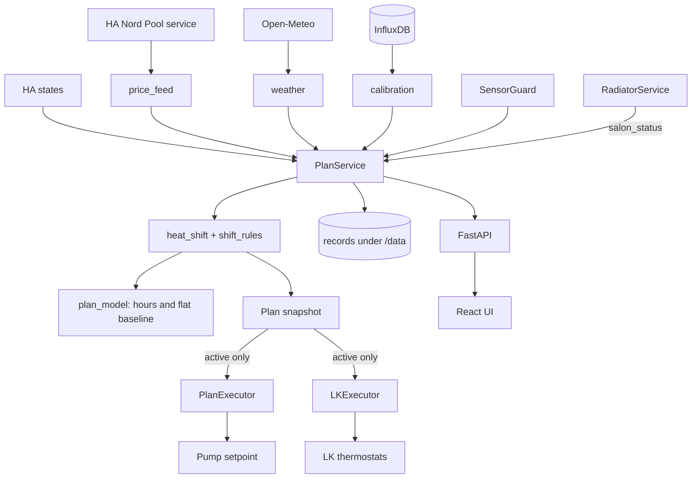

# Theria Software Design

Describes the code as it stands on 2026-11-09 (working tree of `radiator-zones`). What is designed but not built is
listed in [What is designed but not built](#what-is-designed-but-not-built). For why the plan decides what it decides,
and for the heat demand and energy calculations, see [ALGORITHM_EXPLAINED.md](ALGORITHM_EXPLAINED.md). For the hardware,
see [SYSTEM_SETUP.md](../SYSTEM_SETUP.md) and [ivt-heat-pump.md](../documentation/ivt-heat-pump.md).

## System Overview

Theria is a Home Assistant add-on that moves heat pump consumption from dear to cheap hours. Every 15 minutes it reads
the house, Nord Pool prices and the weather forecast, and computes an hourly plan for the pump's room setpoint. In shadow
mode the plan is only recorded. In active mode the plan's setpoint is written to the pump.

The add-on runs in **shadow** mode today. The salon and guest house radiator plans are shadow only in every mode.

## Architecture Principles

- **Algorithm apart from temperatures**: the code decides how; temperatures and limits are settings.
- **One writer, guarded**: every write is range-limited, read back, and paused for an hour after a hand change.
- **Measured state wins**: each plan starts from the measured room; the model only says what a change would do.
- **Everything can be replayed**: each plan run is stored with its inputs, and each hour with what was then measured.
- **No fallbacks that hide faults**: a rejected fit keeps the previous model and says so; a missing input stops the plan.
- **Shadow first**: a new control path runs without writing until it has been reviewed.

## What Theria can and cannot control

| Part | Decides | Theria |
|---|---|---|
| Pump room setpoint (`climate.room_temp_setpoint`) | flow temperature for all circuits | writes in active mode |
| LK thermostats, ground floor (2) | whether that thermostat's floor loops are open | writes in active mode, per room: closing in a sell, opening in a buy just before a sell, otherwise `lk_base_c` |
| Shunts on the floors | cap floor flow at 40 C | not reachable |
| Upper floor (LK IC2) | floor loops, no sensor | not reachable |
| Netatmo, salon | radiator valves, own schedule | shadow only |
| Tado, guest house | radiator valves, own targets | shadow only |
| Hot water, electric heater settings | pump's own control | not reachable |

## Component Map



## Core Components

All paths are under `core/theria/` unless stated.

### PlanService (`plan/service.py`)

The coordinator. `cycle()` runs every 15 minutes, and each step is isolated so that one failure cannot stop the loop:

1. Refit the models if due (24 h interval, 6 h retry after a failure).
2. `run_once()`: compute one plan.
3. `forecast_check.run_due()`: compare finished hours with what the plans said.
4. In active mode only, `_control()`: daily review, conflict check, safety check, write pump, write thermostats, trace.

It also owns the mode (`set_mode`), settings changes, and the state saved over restarts.

### The plan (`plan/heat_shift.py`, `plan/plan_model.py`)

`plan_shift` finds the dear and cheap windows and moves the setpoint a fixed step; `plan_model.HourModel` works out what an hour
at a setpoint means for the floor, the room and the electricity, and gives the flat-setpoint baseline. The result is a `Plan`:
hourly `HourPlan` rows and the baseline. Each hour has `thermostat`: `closing`, `opening` or `normal`; a closing hour has
`valves_closed`. The dynamic-programming optimizer and the regulator were removed on 2026-11-10: the optimizer gave plans that
swung between 15 and 22 C and heated at 4 kr/kWh, and the regulator was never switched on. Git has them.

### Shift rules (`plan/shift_rules.py`)

`balanced` keeps the moved hours matched, so that heat is moved and not cut. `hold_window` keeps a started window to its
end. `guard_reason` ends a sell for the pump when the salon is under its limit or unknown, and an ended window stays ended.
`thermostat_modes` gives the thermostat mode per hour (a guard does not reopen the loops), and `thermostat_target` the value per room.

### Models

| Module | Holds | Changes how |
|---|---|---|
| `plan/house_model.py` | fixed cooling and response curve per zone | by editing the constants |
| `plan/pump_model.py` | flow target and electricity against outdoor and setpoint | refit daily |
| `plan/room_model.py` | ground-floor room and slab step; measured `k_slab`, `k_out`; day heat | constants, measured by hand |
| `plan/daily_room.py`, `night_drift.py`, `warmup.py`, `sun_fit.py`, `morning.py` | daily response, night cooling, warm-up, sun swing, morning margin | refit or learned, within `trim.py` steps |
| `plan/skill.py` | how much of the setpoint range the plan may use | from the prediction error over 3 days |

`plan/calibration.py` and `calibration_data.py` build the fits from InfluxDB and Open-Meteo. The flow curve uses the last
240 days. `plan/model_catalog.py` lists every parameter for the Models tab.

### PlanExecutor and SafetyMonitor (`plan/executor.py`)

Writes the current hour's setpoint, rounded to `rts_step_c` and inside the range. A raise is at most
`max_rts_step_per_hour_c` and at most once per 55 minutes. A plan older than 45 minutes returns the pump to `rts_base_c`.
A value that differs from the last written by 0.25 C or more is a hand change and pauses writing for one hour.
`SafetyMonitor` reports the electric heater running for two checks while the setpoint is raised. It does not stop the plan.

### LKExecutor (`plan/lk_executor.py`)

Writes each LK thermostat, room by room: reads, rewrites while the value read differs, and restores `lk_base_c` when leaving active
mode. A room that cannot be read does not stop the other. Values not yet confirmed are kept as pending for one hour, and any of them
arriving late is not a hand change. A hand change pauses that room for an hour and leaves it alone until the next window.

`PlanService._shift_holds` gives every room its target and the window it belongs to; with no fresh plan every room gets the normal
target.

### RadiatorService (`radiators/`)

Plans the salon (`salon_plan.py`, a dynamic programme with one thermal mass and one loss) and the guest house
(`guest_plan.py`, a band by price rank), and logs what it would write. It never writes to Home Assistant.
`salon_status()` gives the plan the salon's measured mean and its limit for the sell guard: the comfort limit while a Netatmo thermostat asks for at least the open target, otherwise the closed limit. Its salon constants (2.33 MJ/K, 51.7 W/K)
are older than the heat demand analysis in [ALGORITHM_EXPLAINED.md](ALGORITHM_EXPLAINED.md).

### Inputs

| Module | Gives |
|---|---|
| `plan/price_feed.py`, `plan/prices.py` | Nord Pool through HA, aggregated to hours; the extreme-price rule |
| `plan/weather.py` | Open-Meteo forecast, shifted by the measured outdoor bias |
| `sensor_guard.py` | one room temperature from healthy sensors; notifications for failing ones |
| `influxdb_helper.py`, `plan/series.py` | history, aligned to an hourly UTC grid and cleaned of H60 spikes |
| `plan/data_health.py`, `plan/preflight.py` | checks to read before going active |

### Energy forecast (`plan/energy_forecast.py`)

The pump's compressor electricity per hour for the next day, chosen and reviewed in
[energy-forecast](../documentation/energy-forecast/README.md). `EnergyForecaster.run_due` runs in each cycle: after 14:00 local it
issues tomorrow with the weather forecast, and it fills in the last 14 days from what was measured. Each forecast is kept as it was
made in `energy_forecast.jsonl`. `view` joins them with the measured electricity for `GET /api/energy-forecast` and the Energy tab.
It also keeps the fitted heating model, refitted daily and run before the plan in each cycle; the plan service turns it into a table of
kWh per hour and setpoint (`PlanInputs.energy_kwh_table`), which the planner reads instead of the pump model's energy.

### Records and outcomes

| Module | Keeps |
|---|---|
| `plan/plan_run.py` | each plan with all inputs, for replay |
| `plan/plan_record.py` | the plan as decided, per hour, for charts |
| `plan/forecast_check.py` | each finished hour against the plans, by lead time |
| `plan/exec_trace.py` | what each control cycle read, asked for and wrote |
| `plan/event_log.py`, `parameter_log.py` | writes and mode changes; learned parameter changes |
| `plan/outcomes.py` | heating cost per day against a baseline, from meters |
| `plan/debug_export.py` | all of it as one markdown file |

### Older services

`thermal_learning_service.py`, `entity_thermal_learner.py`, `temperature_history_service.py`, `history.py`,
`health_monitor.py` and `heat_pump_monitor.py` run from `backend/app.py` and feed the zone, sensor and health views. They
do not feed the plan.

## Data Flow

### One plan (`run_once`)

```text
prices -> hourly from this hour to the end of what is known
weather + measured outdoor -> outdoor forecast per hour with the bias removed
sensor guard -> measured room; minus the sun swing -> initial level
shift readings -> room, salon status, the window that has started, each room against the mean
energy forecast's model -> a table of kWh per hour and setpoint
plan_shift(inputs, effective settings, pump, room) -> Plan
keep shift window, plan run, snapshot, plan record
```

The effective settings are the stored settings with the setpoint range scaled by `min_authority` and skill, and the night
limits raised by the morning margin.

### One control pass, active only (`_control`)

```text
daily review -> stop if the old setpoint automation is on -> safety check
-> PlanExecutor.execute(latest plan) -> LKExecutor.execute(targets per room, window) -> trace -> save state
```

### Modes

| Mode | Plans | Writes | How entered |
|---|---|---|---|
| shadow | yes | nothing | default |
| active | yes | pump setpoint, LK thermostats | API with `confirm=true`, refused while the old automation is on |

Leaving active mode writes the base values back. If that fails the mode stays active and the error says so.

## Configuration and Settings

| Where | What |
|---|---|
| `config.yaml`, `/data/options.json` | entities, sensors, default plan settings |
| `plan/settings.py` `PlanSettings` | every plan setting, validated at start |
| `/data/plan_overrides.json` | values changed in the UI (`plan/settings_manager.py`) |
| `radiators/settings.py`, `/data/radiator_prefs.json` | radiator configuration and preferences |

## Storage

Everything is under `/data` in the add-on, or `THERIA_DATA_DIR` for a local run.

| File | Content |
|---|---|
| `plan_state.json` | mode, fitted models, executor and LK state, shift window |
| `plan_overrides.json`, `radiator_prefs.json` | settings changed in the UI |
| `plan_runs.jsonl` | plan inputs for replay |
| `plan_record.jsonl` | decided plan per hour |
| `forecast_check.jsonl` | plan against outcome |
| `energy_forecast.jsonl` | the pump's electricity forecast per day, as made |
| `exec_trace.jsonl` | control cycles |
| `plan_events.jsonl`, `plan_parameters.jsonl`, `radiator_events.jsonl` | action logs and learned parameters |

## API

Routers in `backend/`. The plan routes are in `plan_api.py`:

| Route | Purpose |
|---|---|
| `GET /api/plan`, `/plan/day`, `/plan/history` | current plan, one local day, earlier snapshots |
| `POST /api/plan/mode` | change mode |
| `GET /api/model/health`, `POST /api/model/refit`, `GET /api/plan/model` | model fit, refit, every parameter |
| `GET`, `PUT /api/plan/settings`, `DELETE /api/plan/settings/{key}` | settings |
| `GET /api/plan/execution`, `/plan/trace`, `/plan/log`, `/plan/parameters` | what was written and learned |
| `GET /api/plan/runs`, `/plan/forecast-check`, `/plan/preflight`, `/plan/tuning` | replay, plan against outcome, checks, advice |
| `GET /api/savings` | outcome per day |
| `GET /api/energy-forecast` | electricity forecast against measured, and the error |
| `GET /api/export-debug-data` | the debug export |

`radiator_api.py` serves `/status`, `/prefs` and `/log`, `heat_pump_api.py` serves `/heatpump/now` and `/heatpump/timeline`,
`sensor_api.py` serves the comfort sensors, and `api.py` serves the older zone, thermal and health routes.

## Frontend

React and Vite in `frontend/src/`, with one view per tab: Overview, Värmepump, Plan, Savings, Energy, Models, Settings, Sensors,
Control and Radiators.

The Overview's charts read from the room to the price, on one time axis with the sell and buy windows shaded: room temperature (ground floor and salon, measured and
expected, with the thermostat target), heating need per zone and combined (`plan/zone_heat.py`), flow and floor loops, then the pump setpoint and price. The heating need
is each zone's heat loss, calculated from the heat demand analysis, whatever meets it, and cannot be checked per zone: only the whole house has a heat meter. The expected salon is its temperature now plus what the plan
changes, because its forecast does not beat that.

The room temperature and the thermostats are shown per part of the house, as on the Home Assistant climate view: the add-on option
`room_sections` lists each section (Salong, Bottenvåning, Gårdshus, Ovanvåning) with its room sensors and its radiator thermostats
(setpoint from the climate entity, heat demand in percent from Netatmo's `heating_power_request` or Tado's heating sensor).
`plan/room_sections.py` reads them hourly from InfluxDB with the zone measurements; they are display only and the plan does not read
them. The sections with id `ground` and `salon` also carry the plan's own lines, and always get a chart. Sensors that
report only on change are carried on for a few hours; InfluxDB keeps no point for an unavailable or unknown state, so the
loader asks Home Assistant which of the sections' entities are lost now (`silent_since`) and ends them from the hour after
(`cut_after`), as the plan's own salon reading does.

The heating need chart also shows the whole house: its loss `H (room - outdoor)` and the pump heat it should take (the loss less
the free heat F), both from `plan/house_loss.py`, fitted with the other models (`FittedModels.house`) to the pump's heat counter
(`heat_counter_entity`), and that counter's hourly heat as bars (`ZoneMeasured.heat_kwh`). The gap between the two analysed zones
and the whole house is the part of the house without a heat demand analysis.

## Development and Testing

`./dev-start.sh` copies the add-on's settings and state and runs on port 8081 against the real Home Assistant and InfluxDB
in test mode: only the Nord Pool service call gets through. Tests are in `tests/`, run with `pytest`, and the frontend
has its own tests. See [CODING_STANDARDS.md](../CODING_STANDARDS.md).

## What is designed but not built

Closed-loop heat shift: [overall design](superpowers/specs/2026-11-09-closed-loop-shift-design.md) and
[part 1, floor heating](superpowers/specs/2026-11-09-part1-floor-heating-design.md).

Built: a sell closes the floor loops per thermostat, a buy just before a sell opens them, and the executor reads and pauses per room.
Not built: a lead before a sell, window length from measured closed-loop cooling, the energy limit, deviation handling, and the logging
per window.

## Known mismatches

| Where | Mismatch |
|---|---|
| `outcomes.py` | scales measured energy by the model and leaves out hot-water hours; it is not the agreed saving (see the algorithm document) |
| `room_model.valve_open` | fitted on 12 days in mild weather (29 Oct - 10 Nov 2026); refit when colder days are logged |
| `radiators/settings.py` | salon 51.7 W/K against 84 W/K in the analysis |
| `binary_sensor.lk_*_actuator_*` | not written to InfluxDB, so loop state exists only in about 10 days of HA history |
